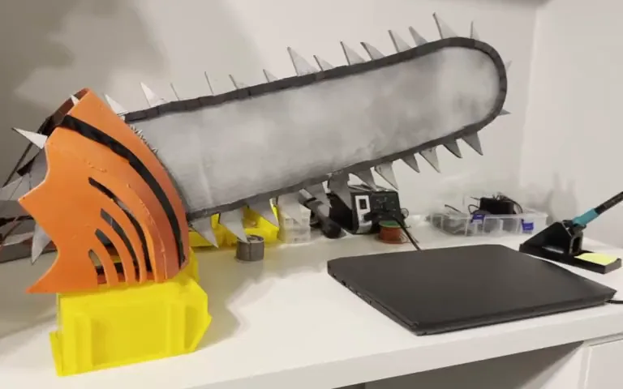
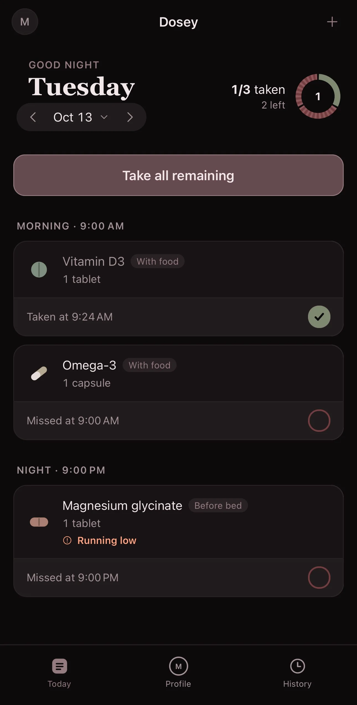
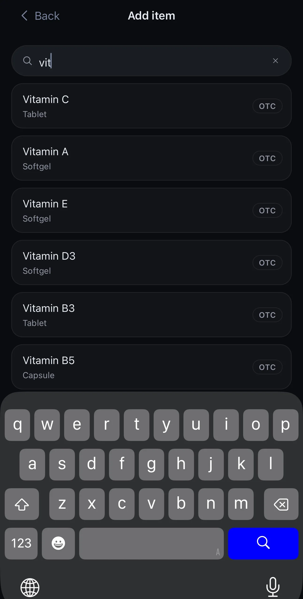
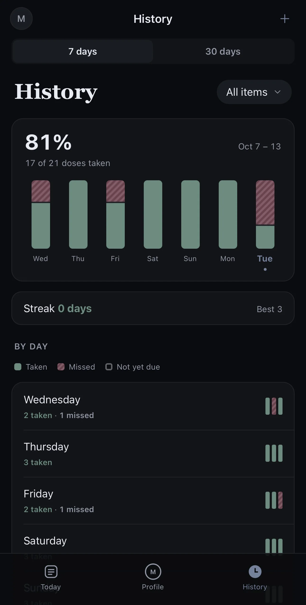

# Majed Khaled Almutairi

### COMPUTER ENGINEERING STUDENT
### Software & Embedded Systems

Based in Kuwait · Open to relocating within KSA

 

---

## About

Hello World. I'm Majed, a third-year Computer Engineering student at the American University of the Middle East (AUM) in Kuwait, expected to graduate in 2028.

Software to me is the mind, and hardware is an extension of it. It's like giving software hands to work with, and watching it use them just as you wrote it to. I got into making things through games in Unity and C#, and these days most of my time goes into embedded systems: Arduino, sensors, soldering, and 3D-printed parts to hold it all together. My favourite part of any project is when it turns from guessing into doing.

> [!TIP]
> I'm looking for a research placement or internship from June to September 2027.
> The full write-ups for my projects are on my [portfolio](https://portfolio-sigma-self-juhjmizuu9.vercel.app), or you can [email me](mailto:majedkhaled0606@gmail.com).

## Right now: [racecar](https://github.com/majedkalmutairi/racecar)

A 1/10 scale RC car that learns to race by itself. You put it on a track it has never seen and it drives one slow lap to map it, then goes faster every lap after that. If I move the walls around, it notices and starts over from the slow lap. The only sensor is a 2D lidar, and all the compute sits on the car.

It starts in a custom 2D simulator built with Python and Pygame, so everything works there before it touches real hardware. That part is done. On 90 random tracks it finished every one without a crash, and its best lap came out 45 to 47% faster than its first race lap. Next is moving the same code onto a Traxxas Slash with a Jetson Orin Nano, an LD19 lidar and ROS 2.

  

## Other things I've made

<table>
  <tr>
    <td width="42%" valign="top">
      
    </td>
    <td valign="top">
      <h3><a href="https://portfolio-sigma-self-juhjmizuu9.vercel.app/projects/motorized-chainsaw-prop">Motorized Chainsaw Prop</a></h3>
      A wearable chainsaw prop with a motor-driven belt of teeth that really runs.
        
      I modelled the pulleys around the motor's D-shaped shaft and printed the bore about 2% undersize so it pressed on and stayed. The belt took longer. Glued leather strips kept snagging and tearing at the joints, so I stitched them instead, then glued HD foam teeth on top. I left that belt running for an hour and came back to find it still spinning.
        
      Blender · 3D printing · Arduino · soldering
    </td>
  </tr>
  <tr>
    <td width="42%" valign="top">
      
    </td>
    <td valign="top">
      <h3><a href="https://portfolio-sigma-self-juhjmizuu9.vercel.app/projects/dosey">Dosey</a></h3>
      A medication and supplement reminder that runs entirely on your iPhone.
        
      I started it to help my family remember their medication when I'm not around. My part was the product design, the decisions and the testing. There's no account and no server, so nothing leaves the phone. It reminds you before, at, and after each dose, warns you before you run out, and its colours shift with the time of day. It's on TestFlight with a handful of people.
        
      iOS · Expo · TestFlight
    </td>
  </tr>
  <tr>
    <td width="42%" valign="top">
      <h3><a href="https://portfolio-sigma-self-juhjmizuu9.vercel.app/projects/parking-system">Arduino Parking Occupancy System</a></h3>
      Tells drivers whether there's a free spot before they enter the lot.
        
      Two ultrasonic sensors watch two spots, each with a red and a green LED. A screen at the entrance shows something like "1/2 slots available", and when everything is taken it says "Parking lot full" and a buzzer goes off. The hard part was the distance threshold: too high and the sensor read the floor as a car, too low and it missed small sedans and coupes. The idea, wiring, code, build and report were all mine.
        
      Arduino · C++ · ultrasonic sensors
    </td>
    <td valign="top">
      <h3>Gym NFC check-in (in progress, private repo)</h3>
      Right now everyone at my university's gym writes their name, ID and time on a paper sheet when they walk in. I'm replacing the sheet with a tap of your student ID.
        
      An ESP32 reads the card with an RC522 reader, shows your name and the time on a small OLED, and beeps. A Flask and SQLite server logs the visit. The reader side works on the breadboard and the server is next. It only reads the card's public UID, and the logs delete themselves after 7 days.
        
      ESP32 · C++ · PlatformIO · Python · Flask
    </td>
  </tr>
</table>

## Tools

Also Pygame, breadboarding and sensors, soldering, 3D printing and FreeCAD.

## Outside of engineering

I play electric guitar, mostly making songs up on the spot. I design props in Blender or CAD and print them out, ideally ones that move or have lights and sounds built in. When I'm not coming up with new projects to steal my time, I'm in the gym.
